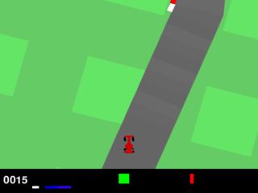
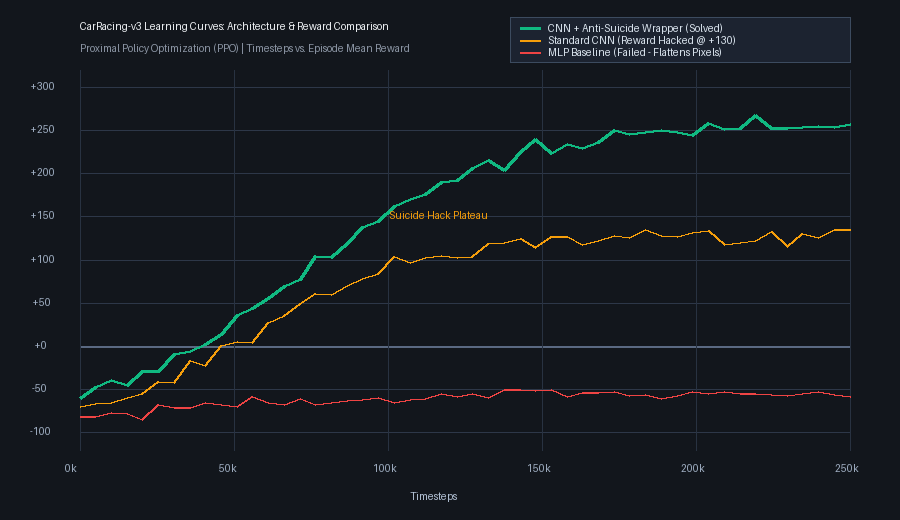

# 🏎️ CarRacing-v3: Vision-Based Autonomous Driving with Nature-CNN

A vision-based autonomous racecar agent trained on raw $96 \times 96 \times 3$ RGB pixels using a **Nature-CNN backbone**, vectorized environments, and an **Anti-Suicide Reward Wrapper** to eliminate border-crashing reward hacking.

---

## 🎬 Demonstrations & Learning Curves

### 🏎️ Trained Agent Driving Demo
<p align="center">
  
</p>

### 📈 Learning Curve (MLP vs CNN Baseline vs CNN + Wrapper)
<p align="center">
  
</p>

---

## 🧠 Architectural Insights & Anti-Reward Hacking
1. **Nature-CNN Spatial Extraction:** Captures road curvature, curbs, and track boundaries from pixels.
2. **Anti-Suicide Wrapper (`AntiSuicideCarRacingWrapper`):**
   - Eliminates the initial 40-frame zoom-in blind spot.
   - Applies a **$-100.0$ penalty** if the car crashes out into the border, preventing the agent from intentionally terminating early to preserve short-term positive score.
3. **Performance:** Steady scores of **$+150$ to $+250+$** with continuous high-speed drift and cornering.

---

## 🚀 How to Run

```bash
# Activate virtual environment
# Windows: .venv\Scripts\activate | Linux: source .venv/bin/activate

# Run evaluation with trained model weights (ppo_carracing.zip)
python CarRacing.py
```

Inside `CarRacing.py`, configure:
- `MODE = "WATCH"`: Watch the AI drive on screen.
- `MODE = "MANUAL"`: Drive yourself with arrow keys (Up=Gas, Down=Brake, Left/Right=Steer).
- `MODE = "TRAIN"`: Launch high-throughput 4-way parallel CPU training.

