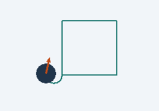

# Differential-Drive Robot Simulator

A top-down Python and Tkinter simulator for a two-wheeled robot. The average wheel speed sets forward motion. The difference in wheel speeds determines how fast the robot turns.



## Run

Use Python 3 with Tkinter. From this project folder, run:

```powershell
python robot_drive.py
```

## Try it

- Set both wheel speeds to 0.50 m/s to drive straight. Set them to -0.15 and 0.15 m/s to turn in place.
- Click the map to set a target. The controller steers toward the point and stops within 5 cm.
- Select **Reset**, then **Drive square**, to follow a square with 1 m sides. The robot stops and turns at each corner. The dashed line is the planned path, and the green trail shows the simulated motion.
- Press **Stop** to cancel the current route and return to manual control.
