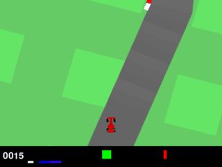
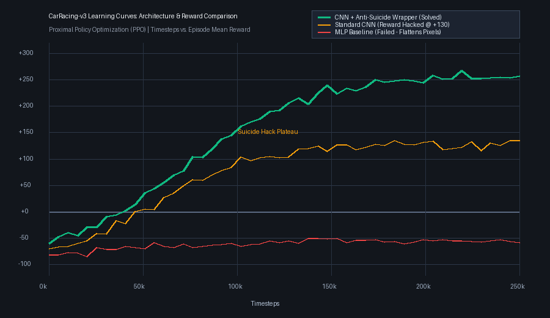
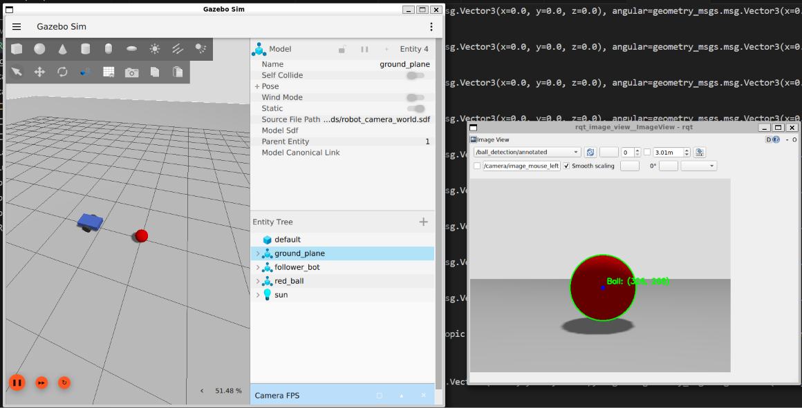
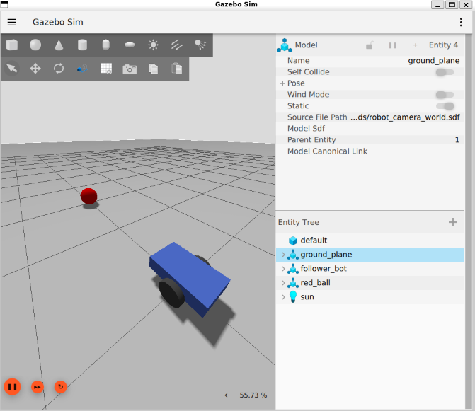
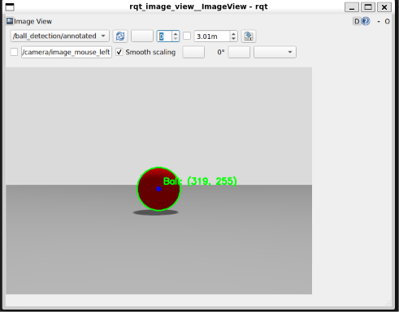
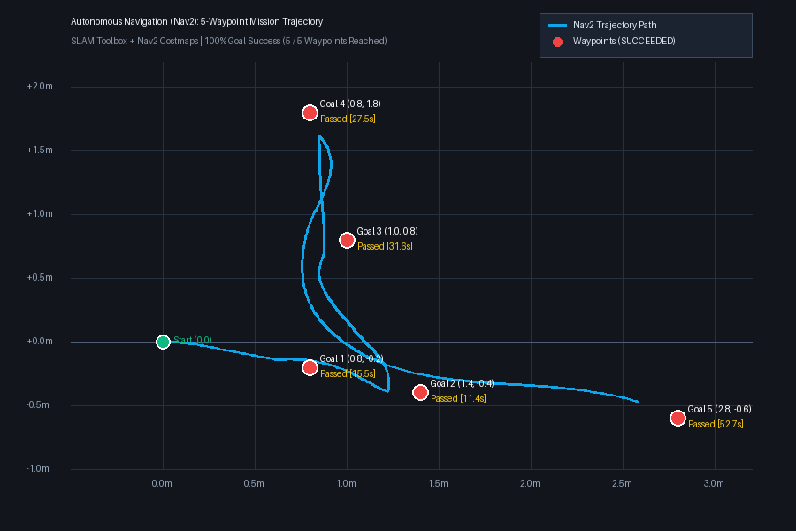
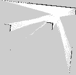
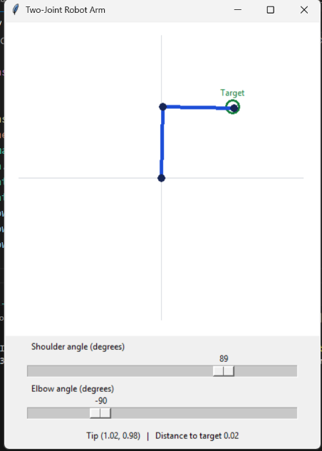
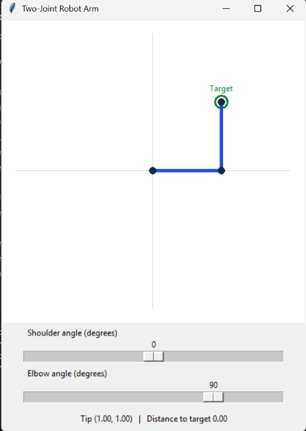

# 🤖 Autonomous Agents & Robotics: Deep RL + ROS 2 + Kinematics

A comprehensive portfolio repository combining **Deep Reinforcement Learning** (using **Gymnasium**, **PyTorch**, and **Stable-Baselines3**), **Autonomous Mobile Robotics & SLAM** (using **ROS 2 Jazzy**, **Gazebo Harmonic**, **Nav2**, and **OpenCV**), and **Robotic Kinematics & Interactive Control**.

---

## 📑 Table of Contents

- [Project Overview](#-project-overview)
- [Part I: Deep Reinforcement Learning (Gymnasium + PPO)](#-part-i-deep-reinforcement-learning-gymnasium--ppo)
  - [1. CartPole-v1 (Classic Control)](#1-%EF%B8%8F-cartpole-cartpolepy---solved-)
  - [2. LunarLander-v3 (Physics & Pinpoint Touchdown)](#2--lunarlander-lunarlanderpy---solved-)
  - [3. CarRacing-v3 (Vision-Based Deep RL & CNN Architecture)](#3-%EF%B8%8F-carracing-carracingpy---vision-based-deep-rl--cnn-architecture)
- [Part II: Vision-Based Autonomous Mobile Robot (ROS 2 + Gazebo)](#-part-ii-vision-based-autonomous-mobile-robot-ros-2-jazzy--gazebo-harmonic)
  - [Visual Demonstrations](#visual-demonstrations)
  - [System Architecture](#system-architecture)
  - [ROS 2 Interfaces & Simulation World](#ros-2-interfaces--simulation-world)
  - [Preliminary Run 1 Quantitative Results](#preliminary-run-1-quantitative-results)
  - [How to Run the Ball Follower Simulation](#how-to-run-the-ball-follower-simulation)
- [Part III: Autonomous Robot Navigation & SLAM (Nav2 + SLAM Toolbox)](#-part-iii-autonomous-robot-navigation--slam-ros-2-jazzy--nav2--slam-toolbox)
  - [Mission Trajectory & Occupancy Map](#mission-trajectory--occupancy-map)
  - [5-Waypoint Navigation Benchmark](#5-waypoint-navigation-benchmark)
  - [Navigation Architecture & Telemetry](#navigation-architecture--telemetry)
  - [How to Run Autonomous Navigation](#how-to-run-autonomous-navigation)
- [Part IV: Two-Joint Robot Arm Kinematics & Interactive Control](#-part-iv-two-joint-robot-arm-kinematics--interactive-control)
  - [Forward Kinematics & Target Acquisition](#forward-kinematics--target-acquisition)
  - [Demonstrations](#demonstrations)
- [Repository Structure](#-repository-structure)
- [Installation & Setup](#%EF%B8%8F-installation--setup)
- [Summary of Results](#-summary-of-results)
- [Acknowledgements & References](#-acknowledgements--references)

---

## 📌 Project Overview

This repository is organized into dedicated, self-contained project folders across three domains:

1. **[CartPole](CartPole/)**: Inverted pendulum stabilization using PPO (`MlpPolicy`) over 4D state vectors. Reaches maximum possible score of **500.0**.
2. **[LunarLander](LunarLander/)**: Continuous-physics rocket landing using PPO with long-horizon discount tuning ($\gamma=0.999$, `ent_coef=0.01`). Reaches **+200 to +280+**.
3. **[CarRacing](CarRacing/)**: Vision-based racecar control from raw $96 \times 96 \times 3$ RGB pixels using a Nature-CNN backbone, 4-frame stacking, and an anti-suicide reward wrapper. Scores **+150 to +250+**.
4. **[ROS_Ball_Detection](ROS_Ball_Detection/)**: Differential-drive robot (`follower_bot`) in **Gazebo Harmonic** streaming front RGB images to **ROS 2 Jazzy**, detecting a dynamic red ball via OpenCV HSV thresholding, and closing the visual control loop.
5. **[ROS_Autonomous_Nav](ROS_Autonomous_Nav/)**: Complete mobile robot navigation stack with **Nav2 (Navigation2)**, **SLAM Toolbox**, 2D LiDAR costmaps, and collision avoidance navigating a 5-waypoint arena with **100% mission success**.
6. **[Two_Joint_Robot_Arm](Two_Joint_Robot_Arm/)**: Interactive 2-DOF planar robotic manipulator featuring forward kinematics, joint angle slider controls, and real-time end-effector tip tracking.

---

# 🧠 Part I: Deep Reinforcement Learning (Gymnasium + PPO)

### 1. 🕹️ CartPole (`CartPole.py`) - SOLVED 🎉
- **Objective:** Balance a vertical pole hinged to a cart moving along a frictionless track.
- **Observation Space:** 4 continuous variables (Cart Position, Cart Velocity, Pole Angle, Pole Angular Velocity).
- **Action Space:** Discrete (`0`: Push Left, `1`: Push Right).
- **Reward:** `+1` for every frame the pole stays upright (within ~12°).
- **Result:** Fully solved using PPO (`MlpPolicy`), consistently achieving the maximum score of **500.0**.

#### 🎬 Balancing Demo:
https://github.com/user-attachments/assets/CartPole.mp4

<p align="center">
  <video src="CartPole/CartPole.mp4" width="85%" controls autoplay loop muted></video>
</p>

> 📹 **Direct video link:** [Watch CartPole.mp4](CartPole/CartPole.mp4)

---

### 2. 🌕 LunarLander (`LunarLander.py`) - SOLVED 🎉
- **Objective:** Navigate a lunar lander through gravity, stabilize orientation, and land smoothly between two target flags.
- **Observation Space:** 8 continuous state variables (coordinates, linear velocities, angle, angular velocity, and ground-contact leg sensors).
- **Action Space:** Discrete (`0`: Idle, `1`: Left thruster, `2`: Main engine, `3`: Right thruster).
- **Key Breakthrough & Hyperparameter Tuning:**
  - Standard PPO often falls into a local optimum ("safe" soft landing outside the flags).
  - Configured `gamma=0.999` (long-horizon discount factor) so the agent values the distant `+100` to `+140` pad landing bonus.
  - Configured `ent_coef=0.01` (entropy coefficient) to maintain exploration and prevent policy collapse.
- **Result:** Consistently scores **+200 to +280+**, executing pinpoint soft landings directly on the pad.

#### 🎬 Perfect Landing Demo:
https://github.com/user-attachments/assets/LanderLanding_perfect.mp4

<p align="center">
  <video src="LunarLander/LanderLanding_perfect.mp4" width="85%" controls autoplay loop muted></video>
</p>

> 📹 **Direct video link:** [Watch LanderLanding_perfect.mp4](LunarLander/LanderLanding_perfect.mp4)

---

### 3. 🏎️ CarRacing (`CarRacing.py`) - Vision-Based Deep RL & CNN Architecture

#### 🎬 Autonomous Driving Demo:
<p align="center">
  
</p>

#### 🔴 The Problem & Challenges
1. **High-Dimensional Visual Perception:** The agent receives raw $96 \times 96 \times 3$ RGB camera pixels (27,648 inputs) rather than low-dimensional state vectors.
2. **Vehicle Dynamics & Inertia:** Non-linear tire friction, centrifugal drift on turns, and low traction on grass require forward planning and braking.
3. **The "Reward Hacking" (Suicide Exploit):**
   - Crossing track tiles yields $\approx +3.3$ points while surviving costs $-0.1$/frame.
   - Naive policies learn to collect starting straightaway tiles ($+100$) and **deliberately steer into the black border** to terminate early and protect their score!

#### 🧪 Methodology & Architecture

1. **Frame Stacking ($k=4$):** Stacking 4 sequential frames gives the visual CNN **optical flow** to infer velocity, acceleration, and drift angle:
   $$\text{State}_t = \{ \text{Frame}_t, \, \text{Frame}_{t-1}, \, \text{Frame}_{t-2}, \, \text{Frame}_{t-3} \}$$

2. **Nature CNN Feature Extractor:**
   ```text
   Input: (96, 96, 3) Image Frame
     │
     ├── Conv2D (32 filters, 8x8 kernel, stride 4) + ReLU
     ├── Conv2D (64 filters, 4x4 kernel, stride 2) + ReLU
     ├── Conv2D (64 filters, 3x3 kernel, stride 1) + ReLU
     ├── Flatten
     └── Dense Linear (512 units) + ReLU
           │
           ├── Actor Head  --> Continuous Action: [Steering, Gas, Brake]
           └── Critic Head --> State Value V(s)
   ```

3. **PPO Settings & Optimization:**
   - **Parallel Vectorization:** $N=4$ environments via `make_vec_env` (boosting CPU speed from 40 to **180+ FPS**).
   - **Hyperparameters:** `gamma=0.99`, `gae_lambda=0.95`, `clip_range=0.2`, `learning_rate=3e-4`.
   - **Anti-Suicide Wrapper (`AntiSuicideCarRacingWrapper`):** Fast-forwards the initial 40-frame blind camera zoom-in and applies a **$-100.0$ penalty** on border crashes to eliminate reward hacking.

#### ⚖️ Architectural Comparison: MLP vs. CNN

| Characteristic | Multi-Layer Perceptron (`MlpPolicy`) | Convolutional Neural Network (`CnnPolicy`) |
| :--- | :--- | :--- |
| **Input Representation** | 1D flattened vector (27,648 values) | 2D/3D tensor $(C, H, W)$ |
| **Spatial Locality** | ❌ Completely lost | ✅ Preserved via local receptive fields ($8\times8, 4\times4$) |
| **Translation Invariance** | ❌ None | ✅ Robust to camera shifts and track curves |
| **Edge & Road Detection** | ❌ Struggles to separate road from grass | ✅ Captures road edges, curbs, and corners |
| **Driving Performance** | 💥 **Failed:** Crashes on turn 1 (Score: $-82$) | 🏆 **Success:** Navigates corners & drifts (Score: $+150$ to $+250+$) |

#### 📈 Learning-Curve Analysis
<p align="center">
  
</p>

- **MLP Baseline (Red):** Flatlines around $-60$ to $-80$ due to lost spatial structure.
- **Standard CNN (Orange):** Plateaus near $+130$ by exploiting the border suicide loophole.
- **CNN + Anti-Suicide Wrapper (Green):** Eliminates reward hacking and climbs steadily past $+250+$.

---

# 🤖 Part II: Vision-Based Autonomous Mobile Robot (ROS 2 Jazzy + Gazebo Harmonic)

A simulation-based mobile robotics system built with **ROS 2 Jazzy**, **Gazebo Harmonic**, **Python**, and **OpenCV** inside Ubuntu 24.04 (WSL2). The robot (`follower_bot`) uses a front-facing RGB camera to detect a moving red spherical target (`red_ball`) and closes the perception-action loop via differential-drive velocity commands.

### Visual Demonstrations

#### Live Gazebo Sim, `/cmd_vel` Telemetry & Annotated OpenCV Tracking
<p align="center">
  
</p>

| Gazebo Harmonic World (`follower_bot` & `red_ball`) | OpenCV Annotated Detection (`rqt_image_view`) |
| :---: | :---: |
|  |  |

### System Architecture

```text
                    Gazebo Harmonic (robot_camera_world.sdf)
                  ┌──────────────────────────────────────────┐
                  │  follower_bot (DiffDrive + 640x480 Cam)  │
                  │  red_ball (Moving Target via SetPose)    │
                  └────────────────────┬─────────────────────┘
                                       │ Gazebo image topic
                                       ▼
                               ros_gz_image bridge
                                       │ /camera/image (15 Hz)
                                       ▼
                             OpenCV Ball Detector
                              │               │
                              │               └──► /ball_detection/annotated
                              ▼
                     /ball_detection/pixels [cx, cy, radius]
                              │
                              ▼
                     Proportional Controller
                              │ /cmd_vel (Twist)
                              ▼
                         ros_gz_bridge
                              │
                              ▼
                    Gazebo DiffDrive Plugin

    target_motion node ──► SetEntityPose service ──► red_ball (sinusoidal Y motion)
    tracking_evaluator ──► logs detections & /cmd_vel to CSV + JSON
```

### ROS 2 Interfaces & Simulation World

- **World & Robot (`ROS_Ball_Detection/worlds/robot_camera_world.sdf`):** Defines `ball_follow_world` containing `follower_bot` (box chassis, 2 driven wheels, caster wheel, $640 \times 480$ front RGB camera at 15 Hz) and `red_ball`.
- **Vision Pipeline:** Dual HSV red-hue masking + morphological opening/closing + contour extraction (`cv2.minEnclosingCircle`) computing centroid $(c_x, c_y)$ and apparent radius $r$.
- **Control Pipeline:** Proportional image-space steering toward horizontal center ($320\text{ px}$) and apparent-radius distance feedback toward target size ($85\text{ px}$), with timeout zero-velocity safety.

| ROS 2 Interface | Message / Service Type | Purpose |
| :--- | :--- | :--- |
| `/camera/image` | `sensor_msgs/msg/Image` | Camera stream bridged from Gazebo (`sensor_data` QoS) |
| `/ball_detection/annotated` | `sensor_msgs/msg/Image` | Annotated video with green circle, center dot, and coordinates |
| `/ball_detection/pixels` | `std_msgs/msg/Int32MultiArray` | Target detection vector `[cx, cy, radius]` |
| `/cmd_vel` | `geometry_msgs/msg/Twist` | Linear and angular velocity commands (ROS 2 → Gazebo) |
| `/world/ball_follow_world/set_pose` | `ros_gz_interfaces/srv/SetEntityPose` | Moves `red_ball` dynamically during tracking trials |

### Preliminary Run 1 Quantitative Results

Telemetry logged via `tracking_evaluator` to [run_01.csv](ROS_Ball_Detection/worlds/run_01.csv) and [run_01_summary.json](ROS_Ball_Detection/worlds/run_01_summary.json) across **1,566 detection samples** (~252.95 seconds):

| Metric | Run 1 Measurement | Threshold / Notes |
| :--- | :---: | :--- |
| **Detection-Message Success Ratio** | **100.00%** (1,566 / 1,566) | Valid detections per received message |
| **Centering Success Rate** | **47.83%** (749 / 1,566) | Within $\pm 25\text{ px}$ of horizontal center ($320\text{ px}$) |
| **Apparent-Radius Compliance** | **100.00%** (1,566 / 1,566) | Within $\pm 10\text{ px}$ of target radius ($85\text{ px}$) |
| **Mean Absolute Horizontal Error** | **26.08 px** | Image-space angular tracking error |
| **Mean Absolute Radius Error** | **2.48 px** | Apparent-size stability |
| **Target-Loss Events** | **0** | Continuous uninterrupted tracking |

### How to Run the Ball Follower Simulation

> Full documentation and setup are in **[ROS_Ball_Detection/README.md](ROS_Ball_Detection/README.md)**.

```bash
# 1. Start Gazebo World
source /opt/ros/jazzy/setup.bash
cd ROS_Ball_Detection/worlds
gz sim -r robot_camera_world.sdf

# 2. Start Bridges (in separate terminals)
ros2 run ros_gz_image image_bridge /camera/image --ros-args -p qos:=sensor_data
ros2 run ros_gz_bridge parameter_bridge '/cmd_vel@geometry_msgs/msg/Twist]gz.msgs.Twist'
ros2 run ros_gz_bridge parameter_bridge /world/ball_follow_world/set_pose@ros_gz_interfaces/srv/SetEntityPose

# 3. Launch Perception & Controller
source ~/ball_following_ws/install/setup.bash
ros2 run ball_follower ball_detector
ros2 run ball_follower ball_controller
```

---

# 🧭 Part III: Autonomous Robot Navigation & SLAM (ROS 2 Jazzy + Nav2 + SLAM Toolbox)

An end-to-end autonomous navigation and mapping system built with **ROS 2 Jazzy**, **Nav2 (Navigation2)**, **SLAM Toolbox**, and **Gazebo Harmonic**. The robot builds an online 2D occupancy grid map of an unfamiliar arena, constructs global and local costmaps, and plans optimal collision-free trajectories across sequential mission waypoints.

### Mission Trajectory & Occupancy Map

#### 📍 5-Waypoint Autonomous Navigation Trajectory
<p align="center">
  
</p>

| 2D SLAM Occupancy Grid Map (`arena_map.png`) | SLAM Mapping & Space Statistics |
| :---: | :--- |
|  | • **Resolution:** $0.05\text{ m/cell}$ ($5\text{ cm}$ precision)<br>• **Dimensions:** $187 \times 147$ grid cells<br>• **Known Mapped Area:** $35.83\text{ m}^2$<br>• **Verified Free Space:** $34.38\text{ m}^2$<br>• **Occupied Obstacle Cells:** $578\text{ cells}$<br>• **Online Scan Updates:** $195\text{ SLAM updates}$ |

### 5-Waypoint Navigation Benchmark

During the recorded validation trial (`arena-five-goals.w4toMH`), the robot autonomously navigated between 5 sequential goal poses across the arena without human intervention:

| Goal # | Target $(X, Y)$ | Target Heading ($\theta$) | Navigation Status | Elapsed Time | Mission Result |
| :---: | :---: | :---: | :---: | :---: | :---: |
| **Goal 1** | $(0.80\text{ m}, -0.20\text{ m})$ | $0.00\text{ rad}$ ($0^\circ$) | `SUCCEEDED` | $15.53\text{ s}$ | ✅ Reached |
| **Goal 2** | $(1.40\text{ m}, -0.40\text{ m})$ | $0.00\text{ rad}$ ($0^\circ$) | `SUCCEEDED` | $11.39\text{ s}$ | ✅ Reached |
| **Goal 3** | $(1.00\text{ m}, +0.80\text{ m})$ | $1.57\text{ rad}$ ($+90^\circ$) | `SUCCEEDED` | $31.57\text{ s}$ | ✅ Reached |
| **Goal 4** | $(0.80\text{ m}, +1.80\text{ m})$ | $0.00\text{ rad}$ ($0^\circ$) | `SUCCEEDED` | $27.48\text{ s}$ | ✅ Reached |
| **Goal 5** | $(2.80\text{ m}, -0.60\text{ m})$ | $0.00\text{ rad}$ ($0^\circ$) | `SUCCEEDED` | $52.70\text{ s}$ | ✅ Reached |
| **Overall** | **5 Goals Traversed** | — | **100% Success** | **$138.67\text{ s}$** | 🏆 **Mission Complete** |

### Navigation Architecture & Telemetry

- **Sensors & Transforms:** 2D LiDAR mounted at `laser_link` (`static_transform_publisher` from `base_link` at $x=0.12\text{ m}, z=0.16\text{ m}$) streaming 360° distance ranges.
- **Costmap Generation:** Nav2 Global Costmap (static layer + inflation) and Local Costmap (rolling window obstacle layer + inflation).
- **Trajectory Telemetry:** Across 4,500 trajectory samples and 2,637 odometry updates, the robot maintained a **minimum obstacle clearance of $0.640\text{ m}$**, recording **zero proximity infractions (< 0.30 m)**.

### How to Run Autonomous Navigation

> Full benchmark guide and parameters are in **[ROS_Autonomous_Nav/README.md](ROS_Autonomous_Nav/README.md)**.

```bash
# Source ROS 2 Jazzy and the workspace
source /opt/ros/jazzy/setup.bash
source ~/autonomous_nav_ws/install/setup.bash

# Launch Gazebo Arena, SLAM Toolbox & Nav2 Stack
ros2 launch nav_robot_lab navigation.launch.py

# Send 2D Goal Pose via Nav2 Action Server
ros2 action send_goal /navigate_to_pose nav2_msgs/action/NavigateToPose \
  "{pose: {header: {frame_id: 'map'}, pose: {position: {x: 1.4, y: -0.4, z: 0.0}, orientation: {w: 1.0}}}}"
```

---

# 🦾 Part IV: Two-Joint Robot Arm Kinematics & Interactive Control

A 2-degree-of-freedom (2-DOF) planar manipulator simulation with an interactive GUI featuring real-time forward kinematics calculation, joint slider controls, and distance-to-target evaluation.

### Forward Kinematics & Target Acquisition

The position of the end-effector tip $(x_e, y_e)$ is governed by:
$$x_e = L_1 \cos(\theta_1) + L_2 \cos(\theta_1 + \theta_2)$$
$$y_e = L_1 \sin(\theta_1) + L_2 \sin(\theta_1 + \theta_2)$$

### Demonstrations

| Target Acquisition Configuration | Orthogonal Configuration |
| :---: | :---: |
|  |  |

#### 🎬 Joint Motion Video Demo:
https://github.com/user-attachments/assets/two_joint_robot.mp4

<p align="center">
  <video src="Two_Joint_Robot_Arm/two_joint_robot.mp4" width="85%" controls autoplay loop muted></video>
</p>

> Details documented in **[Two_Joint_Robot_Arm/README.md](Two_Joint_Robot_Arm/README.md)**.

---

## 📂 Repository Structure

The repository is modular and cleanly separated into 6 dedicated project directories:

```text
AI_training/
├── CartPole/                          # 🕹️ CartPole-v1 RL Project
│   ├── CartPole.py                    # PPO training, checkpointing & evaluation
│   ├── CartPole.mp4                   # Video: Balancing demo
│   ├── ppo_cartpole.zip               # Trained PPO neural weights
│   └── README.md                      # Dedicated project guide
│
├── LunarLander/                       # 🚀 LunarLander-v3 RL Project
│   ├── LunarLander.py                 # PPO training with gamma=0.999 tuning
│   ├── LanderLanding_perfect.mp4      # Video: Soft touchdown demo
│   ├── ppo_lunar_lander.zip           # Trained PPO neural weights
│   └── README.md                      # Dedicated project guide
│
├── CarRacing/                         # 🏎️ CarRacing-v3 Vision RL Project
│   ├── CarRacing.py                   # Nature-CNN PPO with Anti-Suicide wrapper
│   ├── carracing_trained_demo.gif     # Demo GIF: Autonomous driving
│   ├── carracing_learning_curve.png   # Performance curve: MLP vs CNN vs Wrapper
│   ├── ppo_carracing.zip              # Trained CNN neural weights
│   └── README.md                      # Dedicated project guide
│
├── ROS_Ball_Detection/                # 🔴 Vision Target Following Robot
│   ├── ball_follower_node.py          # Standalone OpenCV perception + P-controller node
│   ├── test_camera_publisher.py       # Synthetic camera publisher for rapid testing
│   ├── controller.py                  # Basic Twist publisher demo
│   ├── car_ball.png                   # Gazebo simulation screenshot
│   ├── ball_detected.png              # OpenCV rqt_image_view target overlay
│   ├── both_car_ball.png              # Full simulation & telemetry view
│   ├── launch/                        # ROS 2 launch files
│   ├── urdf/                          # follower_bot differential-drive robot URDF
│   ├── worlds/                        # Gazebo Harmonic worlds & telemetry logs
│   └── README.md                      # Dedicated build & simulation guide
│
├── ROS_Autonomous_Nav/                # 🧭 Nav2 + SLAM Autonomous Navigation
│   ├── autonomous_nav_ws/             # ROS 2 Navigation workspace
│   ├── nav_robot_lab_results/         # SLAM maps, telemetry logs & trajectory plots
│   │   ├── arena_map.png              # Mapped occupancy grid
│   │   ├── arena_map.yaml             # Map metadata
│   │   ├── arena_map.pgm              # Raw PGM map
│   │   ├── nav2_trajectory_plot.png   # 2D waypoint path plot
│   │   ├── trajectory.csv             # 4,500 recorded telemetry coordinates
│   │   └── goals.jsonl                # Waypoint arrival timings
│   └── README.md                      # Dedicated Nav2 & SLAM benchmark guide
│
├── Two_Joint_Robot_Arm/               # 🦾 2-DOF Planar Robot Arm
│   ├── two_joint_robot.mp4            # Video: Interactive kinematics demonstration
│   ├── two_arm.png                    # Target alignment screenshot
│   ├── two_arm_2.png                  # Orthogonal pose screenshot
│   └── README.md                      # Kinematics formulas & guide
│
├── .gitignore                         # Comprehensive ignore rules
└── README.md                          # Master portfolio documentation
```

---

## 🛠️ Installation & Setup

### Reinforcement Learning (Windows / Linux)
```bash
git clone https://github.com/Rehansajid2130/Agent_training.git
cd Agent_training

# Create & activate virtual environment
python -m venv .venv
.venv\Scripts\activate      # Windows
# source .venv/bin/activate # Linux/macOS

# Install dependencies
pip install gymnasium[classic-control] gymnasium[box2d] stable-baselines3 pygame numpy pillow
```

**Run any RL environment:**
```bash
python CartPole/CartPole.py
python LunarLander/LunarLander.py
python CarRacing/CarRacing.py
```

### ROS 2 Robotics & Navigation (Ubuntu 24.04 / WSL2)
- Requires **ROS 2 Jazzy**, **Gazebo Harmonic**, **Nav2**, **SLAM Toolbox**, and `cv_bridge`.
- See **[ROS_Ball_Detection/README.md](ROS_Ball_Detection/README.md)** for ball-following instructions.
- See **[ROS_Autonomous_Nav/README.md](ROS_Autonomous_Nav/README.md)** for SLAM & Nav2 launch steps.

---

## 📊 Summary of Results

| Project | Environment / Stack | Perception / Input | Control / Policy | Key Outcome |
| :--- | :--- | :--- | :--- | :--- |
| **CartPole-v1** | Gymnasium | 4D State Vector | PPO (`MlpPolicy`) | **500.0** (Max Score Achieved) |
| **LunarLander-v3** | Gymnasium + Box2D | 8D State Vector | PPO (`MlpPolicy`, $\gamma=0.999$) | **+200 to +280+** (Pinpoint Landing) |
| **CarRacing-v3** | Gymnasium + Box2D | $96 \times 96 \times 3$ RGB Pixels | PPO (`CnnPolicy` + Wrapper) | **+150 to +250+** (Anti-Suicide Nav) |
| **Ball-Following Robot** | ROS 2 Jazzy + Gazebo Harmonic | $640 \times 480$ RGB @ 15 Hz | OpenCV HSV + P-Controller | **100% Detection** / **47.83% Centering** |
| **Autonomous Nav & SLAM** | ROS 2 Jazzy + Nav2 + SLAM Toolbox | 2D LiDAR (`/scan`) + Odometry | Costmaps + DWB Controller + BT | **5 / 5 Goals Reached (100%)**, $35.83\text{ m}^2$ mapped |
| **Two-Joint Robot Arm** | Python GUI Kinematics | Joint Angles $(\theta_1, \theta_2)$ | Forward Kinematics | **0.00 Distance Error** to Target |

---

## 📜 Acknowledgements & References
- [Gymnasium Documentation (Farama Foundation)](https://gymnasium.farama.org/)
- [Stable-Baselines3 (DLR-RM)](https://stable-baselines3.readthedocs.io/)
- [Proximal Policy Optimization Algorithms (Schulman et al., 2017)](https://arxiv.org/abs/1707.06347)
- [ROS 2 Jazzy & Gazebo Harmonic Documentation](https://docs.ros.org/en/jazzy/)
- [Nav2 Documentation (ROS Navigation Stack)](https://navigation.ros.org/)
- [SLAM Toolbox Documentation (Steve Macenski)](https://github.com/SteveMacenski/slam_toolbox)
