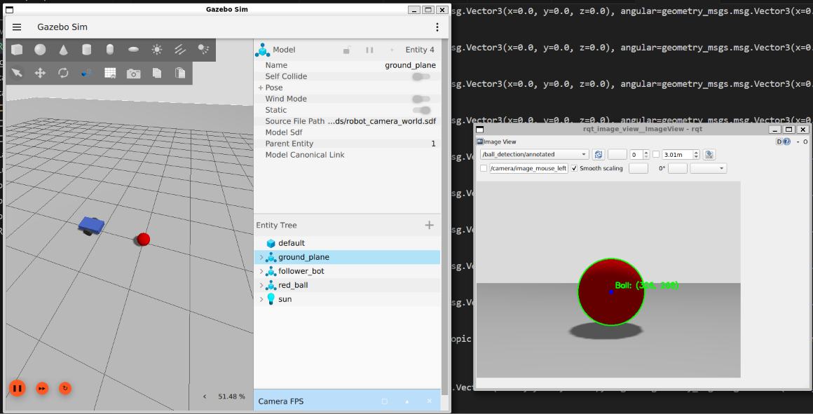
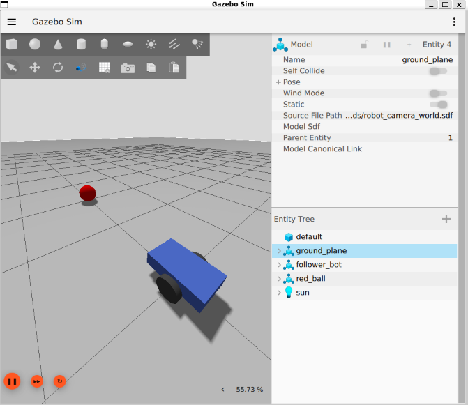
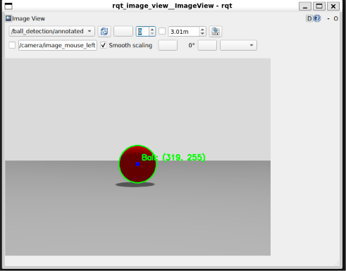

# ROS 2 Vision-Based Autonomous Mobile Robot

A simulation-based mobile-robot project built with **ROS 2 Jazzy**, **Gazebo Harmonic**, **Python**, and **OpenCV**. The robot uses a simulated front-facing RGB camera to detect a red spherical target and a ROS 2 controller to generate differential-drive velocity commands. A separate ROS 2 node moves the target laterally in Gazebo so tracking behaviour can be tested repeatedly.

> **Project status:** The robot model, Gazebo camera, ROS 2 image bridge, OpenCV target detector, velocity bridge, target-pose service bridge, target-motion node, and initial proportional controller have been implemented. Initial static- and moving-target demonstrations have been reported. Quantitative evaluation is ongoing.

## Contents

- [Visual demonstrations](#visual-demonstrations)
- [Project goals](#project-goals)
- [System architecture](#system-architecture)
- [Software and tools](#software-and-tools)
- [Robot and simulation](#robot-and-simulation)
- [ROS 2 interfaces](#ros-2-interfaces)
- [Workspace structure](#workspace-structure)
- [Build the ROS 2 package](#build-the-ros-2-package)
- [Run the simulation](#run-the-simulation)
- [Run the vision and control pipeline](#run-the-vision-and-control-pipeline)
- [Move the target manually](#move-the-target-manually)
- [Record an experiment](#record-an-experiment)
- [Preliminary Run 1 results](#preliminary-run-1-results)
- [Current limitations and next work](#current-limitations-and-next-work)

## Visual demonstrations

### Live Simulation, ROS 2 Velocity Commands & OpenCV Detection
<p align="center">
  
</p>

| Gazebo Harmonic World (`follower_bot` & `red_ball`) | Annotated OpenCV Feed (`/ball_detection/annotated`) |
| :---: | :---: |
|  |  |

## Project goals

1. Create a differential-drive mobile robot in Gazebo.
2. Add a front-facing simulated RGB camera.
3. Stream camera images from Gazebo into ROS 2.
4. Detect a red target using HSV colour thresholding in OpenCV.
5. Estimate the target's image centroid and apparent radius.
6. Use image-space feedback to generate robot velocity commands.
7. Move the target during simulation and evaluate the tracking system.

## System architecture

```text
                    Gazebo Harmonic
              ┌─────────────────────────┐
              │  Differential-drive bot │
              │  Front RGB camera       │
              │  Red target             │
              └────────────┬────────────┘
                           │ Gazebo image topic
                           ▼
                    ros_gz_image bridge
                           │ /camera/image
                           ▼
                    OpenCV ball detector
                       │             │
                       │             └── /ball_detection/annotated
                       ▼
                /ball_detection/pixels
                   [cx, cy, radius]
                           │
                           ▼
                  Proportional controller
                           │ /cmd_vel
                           ▼
                    ros_gz_bridge
                           │
                           ▼
                  Gazebo DiffDrive plugin

    target_motion node ── SetEntityPose service ──► red target
    tracking_evaluator node ── subscribes to detections and /cmd_vel
```

## Software and tools

| Component | Current setup |
|---|---|
| Operating environment | Ubuntu 24.04 on WSL2 |
| Robotics middleware | ROS 2 Jazzy |
| Simulator | Gazebo Harmonic |
| Robot description | SDF |
| Main language | Python 3 |
| Computer vision | OpenCV and NumPy |
| ROS 2 Python API | `rclpy` |
| Image conversion | `cv_bridge` |
| Gazebo/ROS integration | `ros_gz_bridge`, `ros_gz_image`, `ros_gz_sim` |
| Build system | `colcon` with `ament_python` |

## Robot and simulation

The simulation world is `robot_camera_world.sdf` and the Gazebo world name is `ball_follow_world`.

The robot model, `follower_bot`, has:

- A box-shaped chassis.
- Two driven wheels and a differential-drive plugin.
- A caster support wheel.
- A front-mounted RGB camera configured at 640 × 480 pixels and 15 Hz.
- A red spherical target named `red_ball`.

The target-motion node changes the target's world pose through Gazebo's `/world/ball_follow_world/set_pose` service. Its current path is a sinusoidal side-to-side movement along the world Y axis; it is not a full circular trajectory.

## ROS 2 interfaces

| Interface | Type | Purpose |
|---|---|---|
| `/camera/image` | `sensor_msgs/msg/Image` | Camera stream bridged from Gazebo |
| `/ball_detection/annotated` | `sensor_msgs/msg/Image` | Camera image annotated with detection circle and center |
| `/ball_detection/pixels` | `std_msgs/msg/Int32MultiArray` | Detection data `[cx, cy, radius]` |
| `/cmd_vel` | `geometry_msgs/msg/Twist` | Linear and angular velocity commands |
| `/world/ball_follow_world/set_pose` | `ros_gz_interfaces/srv/SetEntityPose` | Changes the target model's pose |

The image bridge is started with sensor-data QoS. The velocity bridge is configured ROS 2 → Gazebo.

## Workspace structure

The simulation files are stored in the Windows project folder, while the ROS 2 Python workspace is in the Ubuntu home directory.

```text
C:\Users\lenovo\Desktop\AI_training\ROS\worlds\
├── robot_world.sdf                  # Earlier robot-only world, if retained
├── robot_camera_world.sdf           # Current robot + camera + target world
├── README.md                         # This file
├── run_01.csv                        # Run 1 time-series measurements
└── run_01_summary.json               # Run 1 aggregate measurements

~/ball_following_ws/
└── src/
    └── ball_follower/
        ├── package.xml
        ├── setup.py
        └── ball_follower/
            ├── ball_detector.py
            ├── ball_controller.py
            ├── target_motion.py
            └── tracking_evaluator.py
```

The listed result files are created after the corresponding experiment has been run and the evaluator is shut down cleanly.

## Build the ROS 2 package

Open an Ubuntu WSL terminal:

```bash
source /opt/ros/jazzy/setup.bash
cd ~/ball_following_ws
colcon build --symlink-install
source install/setup.bash
```

Verify the package executables:

```bash
ros2 pkg executables ball_follower
```

Expected executables:

```text
ball_follower ball_detector
ball_follower ball_controller
ball_follower target_motion
ball_follower tracking_evaluator
```

## Run the simulation

The commands below are intended to run in separate terminals. Keep each long-running process open. Start the robot controller only after the simulation, bridges, and detector are running.

### Terminal 1 — Gazebo world

```bash
source /opt/ros/jazzy/setup.bash
cd /mnt/c/Users/lenovo/Desktop/AI_training/ROS/worlds
gz sim -r robot_camera_world.sdf
```

### Terminal 2 — Camera image bridge

```bash
source /opt/ros/jazzy/setup.bash
ros2 run ros_gz_image image_bridge /camera/image --ros-args -p qos:=sensor_data
```

### Terminal 3 — Velocity bridge (ROS 2 to Gazebo)

```bash
source /opt/ros/jazzy/setup.bash
ros2 run ros_gz_bridge parameter_bridge '/cmd_vel@geometry_msgs/msg/Twist]gz.msgs.Twist'
```

### Terminal 4 — Target pose service bridge

```bash
source /opt/ros/jazzy/setup.bash
ros2 run ros_gz_bridge parameter_bridge /world/ball_follow_world/set_pose@ros_gz_interfaces/srv/SetEntityPose
```

### Terminal 5 — OpenCV ball detector

```bash
source /opt/ros/jazzy/setup.bash
source ~/ball_following_ws/install/setup.bash
ros2 run ball_follower ball_detector
```

### Terminal 6 — Annotated image viewer (optional)

```bash
source /opt/ros/jazzy/setup.bash
ros2 run rqt_image_view rqt_image_view
```

Select `/ball_detection/annotated` in the topic selector.

### Terminal 7 — Autonomous ball controller

```bash
source /opt/ros/jazzy/setup.bash
source ~/ball_following_ws/install/setup.bash
ros2 run ball_follower ball_controller
```

### Terminal 8 — Automatic target motion

```bash
source /opt/ros/jazzy/setup.bash
source ~/ball_following_ws/install/setup.bash
ros2 run ball_follower target_motion
```

### Terminal 9 — Tracking evaluator (only during a recorded trial)

```bash
source /opt/ros/jazzy/setup.bash
source ~/ball_following_ws/install/setup.bash
ros2 run ball_follower tracking_evaluator
```

The evaluator writes measurement rows while running. Press `Ctrl+C` in Terminal 9 to close the CSV and write the JSON summary.

**Safety:** Do not run a separate manual `/cmd_vel` publisher while `ball_controller` is active; simultaneous velocity publishers can issue competing commands. Stop the controller before manually testing movement or repositioning the target.

## Run the vision and control pipeline

The detector uses two HSV ranges for red, applies morphological opening and closing to reduce small noise, extracts external contours, and selects the largest contour above its minimum area. It computes the contour centroid and an enclosing-circle radius.

The detector publishes:

- `/ball_detection/pixels`: `[center_x_px, center_y_px, radius_px]`; an empty array indicates no valid detection.
- `/ball_detection/annotated`: the original image with a green enclosing circle, a blue center marker, and coordinate text.

The controller currently uses proportional image-space steering and apparent-radius distance feedback. It limits linear and angular commands and publishes zero velocity when the target is missing or its last detection is older than the configured timeout. This is a P-controller implementation, not a tuned PID controller.

## Move the target manually

With Gazebo and Terminal 4 (the pose service bridge) running, call the service from another terminal.

Move target to positive world Y:

```bash
source /opt/ros/jazzy/setup.bash
ros2 service call /world/ball_follow_world/set_pose \
  ros_gz_interfaces/srv/SetEntityPose \
  "{entity: {name: 'red_ball', type: 2}, pose: {position: {x: 2.0, y: 0.6, z: 0.14}, orientation: {x: 0.0, y: 0.0, z: 0.0, w: 1.0}}}"
```

Move target to negative world Y:

```bash
ros2 service call /world/ball_follow_world/set_pose \
  ros_gz_interfaces/srv/SetEntityPose \
  "{entity: {name: 'red_ball', type: 2}, pose: {position: {x: 2.0, y: -0.6, z: 0.14}, orientation: {x: 0.0, y: 0.0, z: 0.0, w: 1.0}}}"
```

Return target to the center:

```bash
ros2 service call /world/ball_follow_world/set_pose \
  ros_gz_interfaces/srv/SetEntityPose \
  "{entity: {name: 'red_ball', type: 2}, pose: {position: {x: 2.0, y: 0.0, z: 0.14}, orientation: {x: 0.0, y: 0.0, z: 0.0, w: 1.0}}}"
```

## Record an experiment

The evaluator's default CSV path is configured in `tracking_evaluator.py`. For the Windows project folder, use:

```python
default_path = (
    '/mnt/c/Users/lenovo/Desktop/AI_training/ROS/worlds/run_01.csv'
)
```

It creates a matching JSON summary beside the CSV:

- `run_01.csv`
- `run_01_summary.json`

The CSV contains elapsed time, detection state, image coordinates, radius, horizontal/radius errors, centering and distance flags, stable-following flag, and the observed linear/angular command values.

Change the output filename for each trial (for example, `run_02.csv` and `run_03.csv`) before running another experiment; the evaluator opens its CSV in write mode and will overwrite an existing file with the same name.

### Evaluation definitions

The current evaluator uses these configured thresholds:

- Image horizontal center: 320 px.
- Desired apparent ball radius: 85 px.
- Centering tolerance: ±25 px.
- Radius tolerance: ±10 px.
- Stable-following sample: both centering and radius conditions are satisfied.

These are project-specific evaluation definitions. The radius is an image-space distance proxy and is not a calibrated physical-distance measurement.

## Preliminary Run 1 results

The uploaded Run 1 summary and CSV contain **1,566 detection samples** over approximately **252.95 seconds**.

| Metric | Run 1 result |
|---|---:|
| Detection-message success ratio | 100.00% (1,566 / 1,566) |
| Centering success | 47.83% (749 / 1,566) |
| Apparent-radius tolerance compliance | 100.00% (1,566 / 1,566) |
| Stable-following samples | 47.83% (749 / 1,566) |
| Mean absolute horizontal error | 26.08 px |
| Mean absolute radius error | 2.48 px |
| Recorded target-loss events | 0 |

**Important interpretation of Run 1:** In the uploaded CSV, `cmd_linear_mps` is zero for every recorded sample, while `cmd_angular_rps` varies. Therefore, this log demonstrates continuous detection, image-space measurements, radius-threshold compliance, and angular-command activity, but it does **not** demonstrate forward or reverse motion during this recorded trial. The observed 100% radius compliance is based on an image-radius threshold, not physical distance. The 100% detection-message success ratio means all detection messages received by the evaluator contained a valid detection; it is not a separately measured camera-frame recall against labelled ground truth.

The trial lasted longer than the intended 60 seconds. The evaluator currently records until it is stopped manually; it does not automatically end at 60 seconds.

## Current limitations and next work

1. Diagnose why Run 1 recorded zero linear velocity commands, then repeat the moving-target test with translational motion confirmed in the CSV.
2. Improve horizontal centering; Run 1 centering success was 47.83% under the ±25 px criterion.
3. Conduct target-loss and reacquisition tests; Run 1 had zero loss events, so reacquisition time was not measured.
4. Repeat controlled trials with unique output filenames and compare results across runs.
5. Add calibrated camera-based distance estimation if physical target distance is required.
6. Tune and evaluate a PID controller only after a PID implementation is actually added.
7. Test different target paths, speeds, lighting conditions, and partial occlusions.

## CV description (after further validation)

**Vision-Based Autonomous Mobile Robot for Moving-Target Tracking | ROS 2, Gazebo, Python, OpenCV**

- Developed a simulated differential-drive robot with camera-based perception and ROS 2 velocity control in Gazebo Harmonic.
- Implemented HSV-based target detection using OpenCV and a proportional visual-feedback controller for a moving target.
- Built a ROS 2 target-motion and experiment-logging pipeline to measure detection samples, image-centering error, apparent-radius consistency, and control commands.

Add numerical performance claims to the CV only after repeatable trials confirm them and the zero-linear-velocity issue in Run 1 has been investigated.
