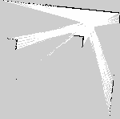
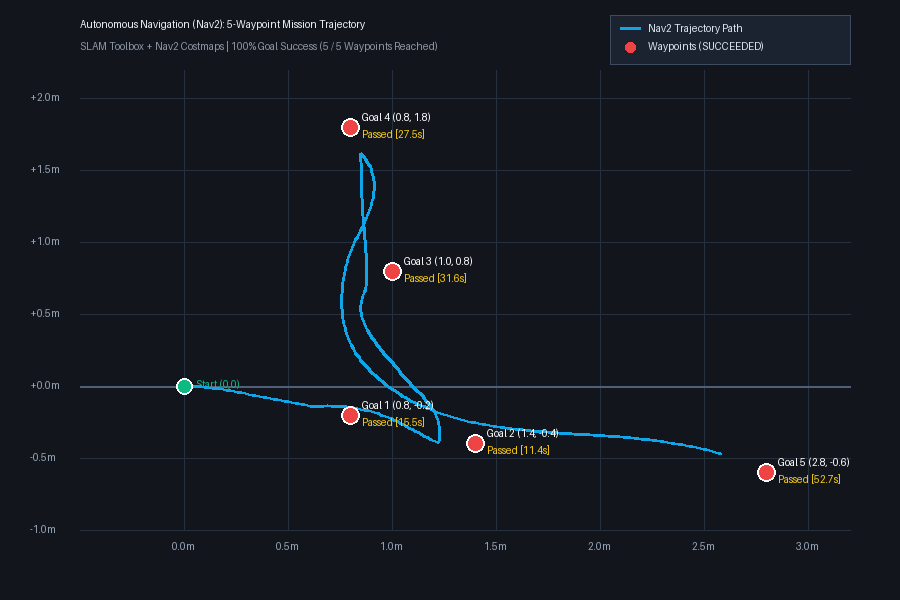

# 🧭 Autonomous Robot Navigation: Nav2 & SLAM in Gazebo Harmonic

An end-to-end autonomous navigation and mapping system built with **ROS 2 Jazzy**, **Nav2 (Navigation2)**, **SLAM Toolbox**, and **Gazebo Harmonic**. The robot maps an unfamiliar arena using 2D LiDAR odometry, generates global and local costmaps, and autonomously plans collision-free paths across sequential target waypoints.

---

## 📌 Mission Overview & Visual Results

### 1. 🗺️ SLAM Occupancy Grid Map
Generated in real-time via `async_slam_toolbox_node` at 0.05 m (5 cm) resolution:

<p align="center">
  
</p>

- **Mapped Known Area:** $35.83\text{ m}^2$ ($34.38\text{ m}^2$ verified free navigable space).
- **Resolution:** $0.05\text{ m/cell}$ ($187 \times 147$ cells).
- **Map Updates:** 195 SLAM scan-match updates without odometry drift.

---

### 2. 📍 5-Waypoint Autonomous Navigation Trajectory
<p align="center">
  
</p>

The robot autonomously navigated across 5 challenging waypoints spread across the mapped arena:

| Goal # | Target $(X, Y)$ | Target Yaw | Status | Duration (Wall Time) | Result |
| :---: | :---: | :---: | :---: | :---: | :---: |
| **Goal 1** | $(0.80\text{ m}, -0.20\text{ m})$ | $0.0\text{ rad}$ | `SUCCEEDED` | $15.53\text{ s}$ | ✅ Reached |
| **Goal 2** | $(1.40\text{ m}, -0.40\text{ m})$ | $0.0\text{ rad}$ | `SUCCEEDED` | $11.39\text{ s}$ | ✅ Reached |
| **Goal 3** | $(1.00\text{ m}, +0.80\text{ m})$ | $1.57\text{ rad}$ ($90^\circ$) | `SUCCEEDED` | $31.57\text{ s}$ | ✅ Reached |
| **Goal 4** | $(0.80\text{ m}, +1.80\text{ m})$ | $0.0\text{ rad}$ | `SUCCEEDED` | $27.48\text{ s}$ | ✅ Reached |
| **Goal 5** | $(2.80\text{ m}, -0.60\text{ m})$ | $0.0\text{ rad}$ | `SUCCEEDED` | $52.70\text{ s}$ | ✅ Reached |
| **Overall** | **5 Goals Traversed** | — | **100% Success** | **$138.67\text{ s}$** | 🏆 **Mission Complete** |

---

## 🏗️ System Architecture & Navigation Stack

```text
                                  Gazebo Harmonic
                         ┌───────────────────────────────┐
                         │   Mobile Robot with 2D LiDAR  │
                         │   Odometry & DiffDrive Plugin │
                         └───────────────┬───────────────┘
                                         │ /scan (LiDAR), /odom
                                         ▼
                            ros_gz_bridge (parameter_bridge)
                                         │
                 ┌───────────────────────┴───────────────────────┐
                 │                                               │
                 ▼                                               ▼
     ┌───────────────────────┐                       ┌───────────────────────┐
     │     SLAM Toolbox      │                       │     TF2 Transforms    │
     │ async_slam_toolbox    │                       │ static_transform_pub  │
     │ (Occupancy Map /map)  │                       │ (base_link->laser_link)
     └───────────┬───────────┘                       └───────────┬───────────┘
                 │                                               │
                 └───────────────────────┬───────────────────────┘
                                         │
                                         ▼
                        ┌─────────────────────────────────┐
                        │           Nav2 Stack            │
                        │ ├── global_costmap / local_cost │
                        │ ├── planner_server (NavFn/A*)   │
                        │ ├── controller_server (DWB/RPP) │
                        │ ├── bt_navigator (Behavior Tree)│
                        │ └── collision_monitor           │
                        └────────────────┬────────────────┘
                                         │ /cmd_vel (Twist)
                                         ▼
                                   ros_gz_bridge
                                         │
                                         ▼
                            Gazebo Mobile Robot Motors
```

---

## 📊 Safety & Performance Telemetry

From high-frequency logging during autonomous navigation ([nav2_run_summary.json](nav_robot_lab_results/nav2_run_summary.json)):

- **Total Trajectory Samples:** 4,500 continuous kinematic samples.
- **Odometry Samples Logged:** 2,637 frames.
- **LiDAR Samples Logged:** 844 scans.
- **Minimum Observed LiDAR Obstacle Clearance:** **$0.640\text{ m}$** (Consistently maintained safe distance from walls and obstacles).
- **Proximity Infractions (< 0.30 m):** **0** (Zero collision risks or near-misses recorded).

---

## 📂 Workspace Structure

```text
ROS/auto/
├── autonomous_nav_ws/          # ROS 2 Colcon build workspace & build logs
│   └── log/                    # Detailed colcon build & lifecycle event logs
└── nav_robot_lab_results/      # Benchmark telemetry, maps & trajectory logs
    ├── arena_map.pgm           # Raw Netpbm occupancy grid map
    ├── arena_map.png           # Formatted occupancy map visualization
    ├── arena_map.yaml          # Map metadata & resolution configuration
    ├── map_stats.json          # Spatial SLAM coverage statistics
    ├── goals.jsonl             # Waypoint status logs (100% SUCCEEDED)
    ├── nav2_run_summary.json   # Navigation duration & clearance summary
    ├── nav2_trajectory_plot.png# 2D trajectory path plot across 5 waypoints
    ├── mapping_run.csv         # SLAM mapping odometry run log
    ├── nav2_run.csv            # Nav2 execution telemetry
    └── arena-five-goals.w4toMH/# Full 4,500-sample trajectory dataset
```

---

## 🚀 How to Run in ROS 2 Jazzy

1. **Source ROS 2 & the Workspace:**
   ```bash
   source /opt/ros/jazzy/setup.bash
   source ~/autonomous_nav_ws/install/setup.bash
   ```

2. **Launch Gazebo Simulation, SLAM & Nav2:**
   ```bash
   ros2 launch nav_robot_lab navigation.launch.py
   ```

3. **Send Waypoint Mission (CLI):**
   ```bash
   ros2 action send_goal /navigate_to_pose nav2_msgs/action/NavigateToPose \
     "{pose: {header: {frame_id: 'map'}, pose: {position: {x: 1.4, y: -0.4, z: 0.0}, orientation: {w: 1.0}}}}"
   ```

