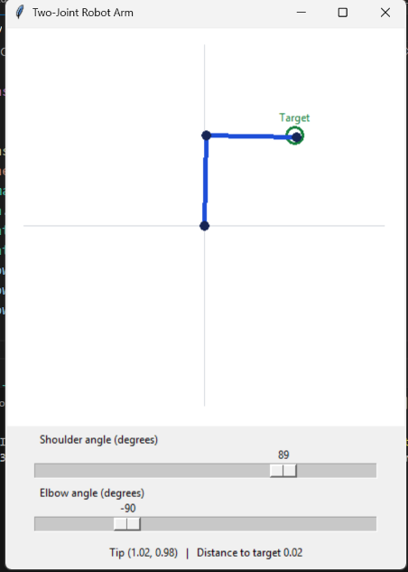
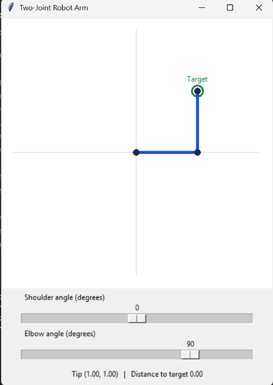

# 🦾 Two-Joint Robot Arm Kinematics & Interactive Control

An interactive 2-degree-of-freedom (2-DOF) planar robotic manipulator simulation featuring forward kinematics, joint angle control sliders, and target tracking.

---

## 📸 Visual Demonstrations

| Target Acquired (Tip at $x=1.02, y=0.98$) | Orthogonal Configuration (Tip at $x=1.00, y=1.00$) |
| :---: | :---: |
|  |  |

### 🎬 Simulation Video Demo
https://github.com/user-attachments/assets/two_joint_robot.mp4

  <video src="two_joint_robot.mp4" width="85%" controls autoplay loop muted></video>

---

## 📐 Kinematics & Mechanics

The 2-link planar manipulator computes end-effector position $(x_e, y_e)$ using standard forward kinematics:
$$x_e = L_1 \cos(\theta_1) + L_2 \cos(\theta_1 + \theta_2)$$
$$y_e = L_1 \sin(\theta_1) + L_2 \sin(\theta_1 + \theta_2)$$

Where:
- $\theta_1$: Shoulder joint angle (controlled between $-180^\circ$ and $+180^\circ$).
- $\theta_2$: Elbow joint angle (controlled between $-180^\circ$ and $+180^\circ$).
- $L_1, L_2$: Link lengths.
- **Target Tracking:** Computes Euclidean distance $d = \sqrt{(x_e - x_t)^2 + (y_e - y_t)^2}$ to the designated goal point.

